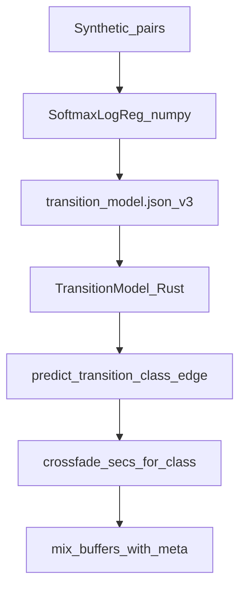
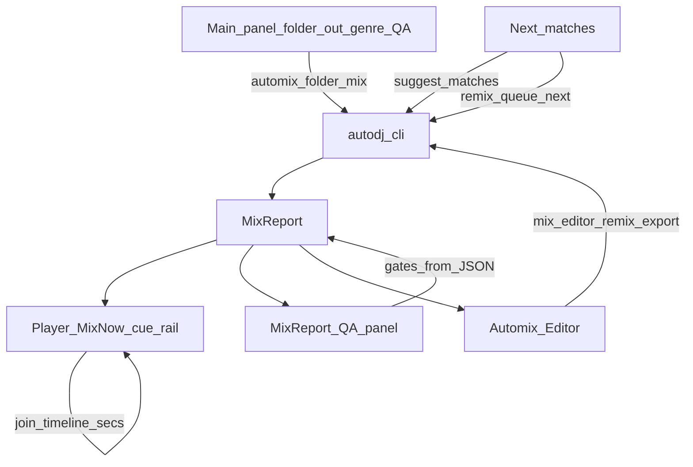

# AutoDJ — Professional Project Writeup

**Status:** P0–P82 on `main` (as of this revision). Full-auto ladder: [`full-auto-roadmap.md`](full-auto-roadmap.md).  
**Living document:** expand / append; never invent unshipped features.  
**Companion specs:** [`competitive-automix-sweep.md`](competitive-automix-sweep.md) · [`architecture.md`](architecture.md) · [`data-contracts.md`](data-contracts.md) · [`getting-started.md`](getting-started.md) · [`mix-quality-rubric.md`](mix-quality-rubric.md) · [`legal-data-policy.md`](legal-data-policy.md) · [`developer-map.md`](developer-map.md) · [`genre-policy.md`](genre-policy.md)

This writeup is a **thesis-grade systems document** (senior full-stack + research rigor) structured Analysis → Design → Implementation → Testing → Evaluation → User Guide → Appendices. There are **no clients and no fabricated interviews**; Analysis uses product personas; Evaluation is **developer-led** against measurable objectives and automated evidence. P74 closed the ungated competitive matrix; **P76** elevates normative requirements, data contracts, algorithm cost models, Softmax empirical metrics, failure modes, and Ops/DX verify matrices—grounded only in shipped code.

---

## Table of contents

1. [Analysis](#1-analysis)  
2. [Design](#2-design)  
3. [Implementation](#3-implementation)  
4. [Testing](#4-testing)  
5. [Evaluation](#5-evaluation)  
6. [User guide](#6-user-guide)  
7. [Bibliography](#7-bibliography)  
8. [Appendices](#8-appendices)  
   - [A — Test evidence index](#appendix-a--test-evidence-index)  
   - [B — Data / legal sources](#appendix-b--data--legal-sources)  
   - [C — Capability ledger](#appendix-c--capability-ledger-p0p76)  
   - [D — How this Doc grows](#appendix-d--how-this-doc-grows)  
   - [E — Screenshot placeholders](#appendix-e--screenshot-placeholders)  
   - [F — Negative capability register](#appendix-f--negative-capability-register)

---

## 1. Analysis

### 1.1 Problem statement

DJs and content creators need **continuous, genre-aware mixes** from their own libraries: tracks ordered for harmonic and energy flow, transitions that feel intentional (EQ swaps, filters, cuts, phrase-aware blends), and loudness suitable for streaming or broadcast. Doing this by hand requires cue points, Camelot knowledge, and careful gain riding.

**AutoDJ** addresses that problem as an **offline automatic mix engine**: ingest a folder or playlist, analyse features, solve a mix order, render a beat-aligned mix to WAV/FLAC, and expose QA (MixReport) plus a desktop shell for listen / edit / rematch—without uploading user libraries or training on pirated commercial sets.

### 1.2 Background

Skilled DJs combine:

- **Harmonic mixing** (Camelot / relative keys) so adjacent tracks share compatible tonality.  
- **Tempo management** (BPM matching, short stretch windows) to avoid audible warble.  
- **Phrase and section awareness** (intro / drop / outro) so mixes land on musical boundaries.  
- **Transition vocabulary** (EQ bass swap, filter sweeps, echo outs, hard cuts, longer blends).  
- **Programme loudness** (EBU R 128 / BS.1770 family) for consistent playback level.

Commercial tools (djay Automix, VirtualDJ Automix, Serato Stems, Rekordbox prep) productise parts of this. AutoDJ targets a **research-grade, offline, open (MIT)** pipeline with **deterministic goldens** and a **lawful learning path** (synthetic transitions + offline tracklist aggregates)—see competitive citations in §7 and [`competitive-automix-sweep.md`](competitive-automix-sweep.md).

### 1.3 Stakeholders / personas

| Persona | Needs | Weight in re-rank |
|---------|--------|-------------------|
| Bedroom DJ / content creator | One-shot folder → mix → listen; Matching; Editor pins | Highest |
| Radio / podcast continuous mix | Stable loudness (−14 / −23 LUFS); long coherent sets | High |
| Club open-format | Wide BPM tolerance; diverse transition classes | Medium |
| Label promo pack | Preserve playlist order; Rekordbox XML fidelity | Medium |

Personas come from standing competitive re-rank guidance (not client interviews).

### 1.4 Research into the problem

**Competitive surface matrix** (summary): offline automix, I/O, analysis, harmonic/energy-arc, FX palette (excl. Neural), cues, Rekordbox, phrase, offline learning, desktop shell, loudness, tempo blend, spectral continuity are **Shipped / Parity (closed)** as of P74. Stems / live dual-deck / neural phrase ML remain **Later / gated**.

**Legal research:** [`legal-data-policy.md`](legal-data-policy.md) forbids commercial set scrapes and unlicensed stems in git/CI; tracklist ingest commits **statistics + citations only**; live 1001Tracklists / Beatport clients are gated.

**Technical research outcomes encoded in product:** SoftmaxLogReg v3 (15-dim, 8 classes), MixReport hard gates under Strict QA, Tauri thin shell over CLI.

### 1.5 Alternative solutions

| Approach | Strengths | Gaps vs AutoDJ goals |
|----------|-----------|----------------------|
| djay / VirtualDJ Automix | Polished UX, Mix Now, FX palette | Closed; limited offline golden/CI story |
| Serato Stems | Stem-aware FX | Stem DSP gated for AutoDJ without user-owned stems |
| Rekordbox + DJ.Studio | Prep + Camelot messaging | Not a full offline render/QA pipeline under MIT |
| Manual Ableton / DJ software | Full control | High skill/time cost |
| **AutoDJ** | Offline MIT core; goldens; Softmax; Tauri; lawful data | No stems/live yet; WebKit CI deferred |

### 1.6 Objectives

#### 1.6.1 Functional objectives (FO)

| ID | Objective | Measurable success |
|----|-----------|-------------------|
| FO1 | Analyse library audio (WAV/FLAC) for BPM/key/sections | Gold analyze ±1 BPM; FLAC CI analyze |
| FO2 | Solve mix order (harmonic + tempo + energy arc) | Graph unit tests; Folder Automix |
| FO3 | Softmax per-edge transition classes (8-class) | `--golden transition_model`; train eval ≥ 0.90 |
| FO4 | Genre preferred transitions without Softmax | `--no-transition-model`; `--golden transitions` |
| FO5 | Phrase/section-aware cues + overrides | `cue_phrase_aligned`; cue/Rekordbox override goldens |
| FO6 | Class-aware FX crossfades + tempo blend | EQ/Dissolve unit tests; smoke `tempo_blend_applied` |
| FO7 | R128 loudness (−14 / −23) + peak limit | smoke/broadcast goldens; MixReport gates |
| FO8 | MixReport QA sidecar + stdout JSON | `{out}.mixreport.json`; CI smoke assert |
| FO9 | Rekordbox XML ingest + preserve-order | `--golden rekordbox` / `rekordbox_cue_overrides` |
| FO10 | Automix Matching (suggest / remix) | Graph tests; CLI + Tauri Next matches |
| FO11 | Tauri Folder Automix → listen → Editor | Desktop flows; Mix Now / `N` |
| FO12 | Policy hints from offline aggregates | `--golden policy_hints` |
| FO13 | Export WAV or FLAC | `write_audio`; `--out .flac` |

#### 1.6.2 Non-functional objectives (NFO)

| ID | Objective | Measurable success |
|----|-----------|-------------------|
| NFO1 | Deterministic CI goldens | All listed goldens exit 0 on CI |
| NFO2 | Offline / on-device library privacy | No upload path; legal policy |
| NFO3 | Modular maintainability | Cargo crates + Python train split |
| NFO4 | Mac-first desktop usability | Tauri busy guards + `aria-busy`; path Browse; offline fonts (P68, P78) |
| NFO5 | Lawful data only | No forbidden audio in git; gated scrapes |
| NFO6 | Real-time-safe DSP discipline | Offline render path; no RT alloc on hot docs rules |

#### 1.6.3 Objective prioritisation

Shipped P0–P76 closed the ungated mix-quality, shell, Docs-depth, niche CLI↔Tauri parity, competitive-matrix honesty, and thesis-documentation gaps. The competitive surface matrix now marks offline automix, I/O, analysis, harmonic/energy-arc, FX palette (excl. Neural), cues, Rekordbox, phrase, learning (offline), desktop shell, loudness, tempo blend, and spectral eval as **Shipped / Parity (closed)**. Remaining matrix **Gap** is stems-aware transitions (Later / user-owned audio); live dual-deck and neural phrase ML stay Later. Personas weighted bedroom DJ and radio continuous mix first—hence loudness, Folder Automix, Matching, and Editor before gated live/stems.

### 1.7 Modelling the problem

#### 1.7.1 Decomposition

1. **Decode** → `AudioBuffer`  
2. **Analyse** → features + quality → optional SQLite Feature DB  
3. **Solve** → order + transition classes (Softmax or preferred)  
4. **Cue** → mix-in/out windows, phrase bars, overrides  
5. **Render** → WSOLA + EQ/FX + R128 + eval gates  
6. **Report** → MixReport JSON + audio out  
7. **Shell** → Tauri invokes CLI; listen / match / edit  

#### 1.7.2 Logical architecture

ASCII companion (same story as [`architecture.md`](architecture.md)):

```
playlist JSON / Rekordbox XML ──► apps/autodj-app (Tauri) ──┐
        │                                                    │
        ▼                                                    ▼
 autodj-io ──► autodj-core (analyze + rekordbox) ──► SQLite feature cache
        │
        ▼
 autodj-graph (solve_order | preserve_order + TransitionModel)
        │
        ▼
 autodj-core (cues → WSOLA + EQ xfade + R128 + eval) ──► WAV/FLAC + MixReport
        │
 autodj_train: synth → Softmax JSON + policy_hints aggregates
```

```mermaid
flowchart LR
  playlist[Playlist_JSON_or_Rekordbox] --> tauri[autodj_app_Tauri]
  playlist --> io[autodj_io]
  tauri -->|CLI_argv| cli[autodj_cli]
  cli --> io
  io --> coreA[autodj_core_analyze]
  coreA --> db[(Feature_DB)]
  coreA --> graph[autodj_graph]
  graph -->|order_classes| coreC[autodj_core_cues]
  coreC --> coreR[autodj_core_WSOLA_EQ_R128_eval]
  coreR --> outAudio[WAV_or_FLAC]
  coreR --> report[MixReport_JSON]
  report --> tauri
  train[autodj_train] -->|transition_model_json| graph
  train -->|policy_hints| graph
```

#### 1.7.3 Softmax / transition model

Softmax **v3**: 15-dim vector (BPM pair, |ΔBPM|, Camelot distance, energy ΔdB, stretch clamp excess, spectral centroid Δ, phrase bars + mismatch, genre one-hots) → **8 classes** including `dissolve`. Artifact: `python/autodj_train/models/artifacts/transition_model.json`.



Ordinary `mix` loads the committed artefact by default; `--no-transition-model` / Skip Softmax falls back to genre `preferred_transition`. Legacy v1/v2 and pre-* class-count JSON still load via version dispatch.

#### 1.7.4 MixReport as QA model

MixReport carries order, cues, transitions, loudness, spectral/join/bass/stretch/beat-phase/peak/prep gates, override flags, and timeline fields for Mix Now UI. Sidecar: `{out}.mixreport.json`. Hard-gate criteria live in [`mix-quality-rubric.md`](mix-quality-rubric.md); excerpt in §4.3.

### 1.8 Requirement derivation

Requirements flow from: persona needs × competitive gaps × legal constraints → FO/NFO → P-row backlog in the sweep → shipped symbols on `main`. Each FO maps to at least one golden, unit test, or Tauri command (see §2.6).

### 1.9 Constraints

- MIT license; no copyrighted commercial audio in git/CI.  
- Offline-first; user libraries stay local.  
- Primary UI platform: macOS Apple Silicon; Tauri WebKit CI on Ubuntu deferred.  
- Encode/decode: WAV + FLAC only (export default WAV for HTML5 autoplay).  
- Stems / live dual-deck / neural phrase ML not in v1 scope.

### 1.10 Assumptions

- Input audio is user-owned or royalty-free fixtures.  
- Gold loops are short synthetic WAVs (and one FLAC) sufficient for CI, not for human listening sign-off on real vinyl.  
- Committed Softmax artefact remains available at the documented path for ordinary mix.  
- CLI is the source of truth; Tauri mirrors niche mix flags (`--report-out`, `--no-loudness-norm`) as of P73.

---

### 1.11 Normative requirements (REQ register)

Requirements are **normative**: each REQ maps to at least one FO/NFO and automated evidence. Priority: **Must** = v1 sign-off; **Should** = shipped polish; **Must-not** = legal/gated veto.

| ID | Priority | Statement | FO/NFO | Evidence |
|----|----------|-----------|--------|----------|
| REQ-A1 | Must | Analyse user WAV/FLAC for BPM/key/sections with quality flags | FO1 | gold analyze; FLAC CI |
| REQ-M1 | Must | Solve or preserve mix order with harmonic + tempo + energy costs | FO2 | graph tests; Folder Automix |
| REQ-T1 | Must | Select per-edge FX class via Softmax v3 by default | FO3 | `transition_model` golden; eval ≥ 0.90 |
| REQ-T2 | Must | Allow Softmax opt-out to genre preferred transitions | FO4 | `transitions` golden; Skip Softmax |
| REQ-C1 | Must | Phrase/drop-aware cues with absolute override precedence | FO5 | cue goldens |
| REQ-D1 | Must | Render class-aware crossfades + WSOLA ±15% clamp honesty | FO6 | DSP units; smoke |
| REQ-L1 | Must | R128 normalize to −14 or −23 (±2 LU) unless peak-limit | FO7 | smoke + broadcast |
| REQ-Q1 | Must | Emit MixReport sidecar + stdout JSON with hard gates | FO8 | sidecar CI |
| REQ-R1 | Must | Ingest Rekordbox XML with preserve-order fidelity | FO9 | rekordbox goldens |
| REQ-K1 | Must | Rank next matches / pin remix from same cost surface | FO10 | suggest/remix tests |
| REQ-U1 | Should | Desktop shell over CLI with busy/honest listen | FO11, NFO4 | Tauri P37–P73, P78 |
| REQ-P1 | Should | Offline policy hints merge into genre policy | FO12 | `policy_hints` golden |
| REQ-I1 | Must | Encode/decode WAV and FLAC | FO13 | io tests; P67 |
| REQ-N1 | Must | CI reproduces goldens on ubuntu + macos | NFO1 | `.github/workflows/ci.yml` |
| REQ-Z1 | Must-not | No upload of user libraries; no pirated training audio in git/CI | NFO2, NFO5 | [`legal-data-policy.md`](legal-data-policy.md) |
| REQ-G1 | Must-not | Do not ship stems / live dual-deck / neural phrase as v1 | — | Appendix F |

**Legal / privacy (normative negatives).** Allowed: local user audio, synthetic fixtures, aggregate statistics with citations. Forbidden in git/CI: commercial set scrapes, unlicensed stems, secrets, wholesale paywalled HTML ([`legal-data-policy.md`](legal-data-policy.md)). Tracklist automation that violates ToS is **gated**—offline fixtures only.

**Threat / trust boundary (concise).** AutoDJ is a local offline pipeline. Trust boundary: user-supplied paths + optional Feature DB on disk. No network service in the mix path. Residual risks: path traversal via malicious playlist paths (OS permissions apply); subprocess CLI invoked by Tauri (argv built in Rust, not shell-interpolated strings from free text beyond path fields).


## 2. Design

### 2.1 Design goals / rationale

| Goal | Rationale |
|------|-----------|
| Modular Rust crates + Python train | Clear ownership; train never links into CLI runtime |
| CLI as source of truth | Goldens, scripting, Tauri all share one binary surface |
| Thin Tauri shell | Faster iteration; DSP stays in core |
| Deterministic Strict QA mode | Reproducible CI; hard-fail on critical MixReport gates |
| Lawful learning only | Synthetic + aggregates; competitive excellence without piracy |
| Extensible Softmax / FX classes | Versioned artefacts; class palette grows with evidence |

**Technology:** Rust (analysis/DSP/solver/CLI), Python numpy Softmax (CI), Tauri 2 + TypeScript (desktop), SQLite feature cache, hound/claxon/flacenc I/O.

**Trade-offs:** No stems yet; HTML5 may fail FLAC autoplay (WAV preferred); greedy solver (not full TSP) for interactive latency; Softmax trained on synthetic pairs (not commercial sets).

### 2.2 System architecture

Layers:

1. **I/O** (`autodj-io`) — `read_audio` / `write_audio`.  
2. **Core** (`autodj-core`) — analysis, Rekordbox, cues, EQ/FX, WSOLA, R128, eval.  
3. **Graph** (`autodj-graph`) — costs, Softmax, matching/remix, policy hints.  
4. **CLI** (`autodj-cli`) — `analyze` / `mix` / `suggest` / `remix` + goldens.  
5. **Train** (`python/autodj_train`) — synth, train, eval, aggregates.  
6. **App** (`apps/autodj-app`) — Tauri commands wrapping CLI.

Control flow: UI → invoke → `run_autodj` argv → MixReport JSON → UI panels / player. End-to-end graph: §1.7.2. Dense crate notes: [`architecture.md`](architecture.md).

Error handling: CLI non-zero + stderr; Tauri surfaces plain report + progress log; Strict QA bails on hard gates.

#### 2.2.1 Failure modes and degraded behaviour

| Failure / degrade | Detection | System response | User-visible |
|-------------------|-----------|-----------------|--------------|
| <2 wav/flac in folder | `collect_folder_audio` | Err string | Automix folder fails |
| Unreadable / corrupt audio | decode `Result` | CLI/Tauri error | Report panel error |
| Sparse / low-confidence analysis | `AnalysisQuality` | Prep gate fail under Strict QA | Weak pills; hard-fail |
| Softmax file missing | resolve path | Ordinary mix may omit model / err depending on path | Prefer Load committed |
| Strict QA gate fail | MixReport flags | CLI non-zero when deterministic | Fail callout + gate pills |
| Subprocess crash / non-zero | `run_autodj` | Tauri `Err(stderr)` | Plain report |
| HTML5 decode fail (e.g. FLAC) | `audio` error | Honest listen hint | Not “playing” |
| Short gold loops | phrase residual | skip-with-pass on some phrase gates | Documented in rubric |

**Qualitative budgets (no invented wall-clocks):** feature extract ~O(samples); greedy solve O(n²) pairwise for setlist-scale n; Softmax O(F·C) per edge; render O(output samples). Interactive Folder Automix targets “seconds to tens of seconds” on Apple Silicon for small libraries—measure locally; not a CI SLO.

### 2.3 Data / module design

| Concept | Role |
|---------|------|
| `AudioBuffer` | Interleaved f32 PCM, sample rate, channels |
| Playlist JSON / Rekordbox XML | Paths + optional BPM/key/cues/`transition_out`/`bars_per_phrase` |
| Feature DB (SQLite) | Cached analysis for mix/suggest |
| `TransitionModel` | Softmax weights/classes (v1–v3 loaders) |
| `GenrePolicy` | Builtin BPM centres, xfades, preferred transitions |
| MixReport | QA + timeline + order for UI |
| CueOverrides / EditorTrack | Absolute mix windows + pins for re-mix |

Ownership: decode/analyse produce features; graph consumes features → order/classes; renderer consumes buffers + plan → audio + MixReport.

**Normative schemas:** playlist JSON, MixReport, Softmax artefact, Feature DB DDL, policy hints — [`data-contracts.md`](data-contracts.md). Softmax version matrix and Feature DB columns are normative for interop (Python train ↔ Rust runtime).

### 2.4 Algorithm design

| Algorithm | Purpose | Notes |
|-----------|---------|-------|
| Feature extraction | BPM/key/sections/spectral centroid | Offline; `AnalysisQuality` |
| `solve_order` | Greedy NN + energy-arc phases | Key-route discount; stretch costs |
| Softmax `predict_transition_class_edge` | Per-edge FX class | Default on ordinary mix |
| `plan_segment_cues` | Mix-in/out windows | Phrase LCM; drop-aware; overrides win |
| WSOLA tempo blend | Multi-BPM joins | Head + tail; clamp ±15% |
| EQ/FX crossfades | Class-specific blends | EqSwap bass-overlap scored |
| R128 normalize + true-peak | Loudness / peak | Streaming −14 / Broadcast −23 |
| Eval gates | Spectral/join/bass/stretch/beat-phase | Hard-fail when deterministic |

Complexity (prose): analysis roughly linear in samples; greedy solve O(n²) pairwise costs for small n (DJ setlists); Softmax predict O(features × classes) per edge; render linear in output samples.

#### 2.4.1 Order solve (`crates/autodj-graph`)

`solve_order` builds a greedy nearest-neighbour path over unused tracks. Opener: quietest track in genre BPM band (`select_opener`), else global quietest. Each candidate edge is scored by `pair_cost_edge` (`crates/autodj-graph/src/lib.rs`).

**Closed-form cost (shipped constants):**

\[
\mathrm{cost}(a,b,\phi) = C_{\mathrm{key}} + C_{\mathrm{bpm}} + C_{\mathrm{energy}}(\phi)\,w_e + C_{\mathrm{center}} + C_{\mathrm{style}} + 12\cdot\mathrm{stretch\_clamp\_excess}(a,b)
\]

- \(C_{\mathrm{key}} = \max(0,\, d_{\mathrm{Camelot}}(a,b) - 0.75)\) when `to ∈ suggest_next_keys(from)`, else raw distance (`HARMONIC_ROUTE_DISCOUNT = 0.75`).
- \(C_{\mathrm{bpm}} = 10 + |\Delta\mathrm{BPM}|\) if \(|\Delta\mathrm{BPM}| > \mathrm{max\_bpm\_delta}\), else \(0.35\,|\Delta\mathrm{BPM}|\).
- \(C_{\mathrm{center}} = 0.02\,|\overline{\mathrm{BPM}} - \mathrm{bpm\_center}|\).
- \(C_{\mathrm{energy}}\) piecewise on `ArcPhase` ∈ {Opening, Build, Peak, Cool} (rise preferred early; quiet arrivals penalised at Peak; fall preferred in Cool)—see `energy_arc_cost`.
- \(C_{\mathrm{style}} =\) soft crossfade style penalty + `policy_transition_penalty` for resolved class vs genre preferred.
- Stretch weight `STRETCH_EXCESS_WEIGHT = 12`.

```
for each next slot:
  phase ← arc_phase(slot, n)
  pick unused j minimizing pair_cost_edge(prev, j, phase, model?)
emit order + resolved TransitionClass per edge
```

**Invariants:** solution `order` is a permutation of input indices; `|transitions| = n−1` for n≥1; class resolution precedence **playlist `transition_out` override ≻ Softmax (if loaded) ≻ genre `preferred_transition`**. Greedy NN is **not** globally optimal (TSP); chosen for interactive latency on DJ-scale n.

`preserve_order` skips the solve and keeps playlist indices (Rekordbox / Editor Apply). Matching uses the same cost surface: `rank_next_matches` sorts candidates from a now-playing track; `build_remix_order` pins a forced next after a prefix.

**Edge cases:** n=0/1 → trivial / empty transitions; empty suggest folder → error; override index alignment is on **input feature indices**, not solved order (`apply_transition_overrides` docs).

#### 2.4.2 Softmax class + xfade length

Features (15-dim v3) → logits → argmax among eight classes: `linear_crossfade`, `eq_swap`, `filter_sweep`, `echo_out`, `tremolo`, `riser`, `dissolve`, `hard_cut`. `crossfade_secs_for_class` scales policy crossfade by class (HardCut → 0). Playlist `transition_out` wins via `apply_transition_overrides`.

| Softmax version | Dim | Classes (artefact) | Holdout notes |
|-----------------|----:|--------------------|---------------|
| v1 | 11 | 5 core | Legacy `transition_model_v1.json` |
| v2 | 13 | 5 core (+ stretch/spectral feats) | `transition_model_v2.json` |
| v3 | 15 | **8** (incl. tremolo/riser/dissolve) | Default committed artefact; CI gate |

Python↔Rust feature lockstep: `features.py` / `transition_model.rs` ([`data-contracts.md`](data-contracts.md) §3). Empirical numbers: §5.6.

#### 2.4.3 Cues (`plan_segment_cues`)

Per track: estimate `bars_per_phrase` ∈ {4,8,16}; snap mix-out/in to phrase grids; join edges use `phrase_bars_lcm` when both sides phrase-snap. Drop-aware windows prefer `drop_start`. Absolute `CueOverrides` (JSON `mix_in_secs`/`mix_out_secs` or Rekordbox Type 1/2) override planner windows and set MixReport `cue_mix_override_applied`.

#### 2.4.4 Tempo blend + eval

Multi-BPM joins: `tempo_blend_head` + `tempo_blend_tail` (WSOLA) with stretch ratio clamped ±15%; excess feeds MixReport `tempo_stretch_gate_pass` and solver cost. After render, `eval.rs` fills spectral continuity, join flux, bass overlap (EqSwap), beat-phase mean, peak, loudness gates — hard-fail under `--deterministic` / Strict QA.

### 2.5 Interface design

**Main panel:** library folder, output audio, genre, preserve-order, Strict QA, LUFS, Feature DB Browse/New, Automix folder.  
**Player:** HTML5 audio, cue segments, join ticks, Mix Now, Autoplay, Next matches, Automix Editor.  
**Advanced:** playlist Browse, analyze Browse, policy hints, Softmax path / Skip Softmax.  
**Reliability (P68/P78):** busy lock covers controls, player actions, Matching, MixReport panel (incl. Editor), and cue/join seek chrome; `aria-busy` on `main.shell`; Mix Now / `N` blocked while CLI busy; honest autoplay failure; folder infer for matches; offline system font stack (no Google Fonts CDN).



Advanced also exposes MixReport path Browse (`--report-out`) and Peak limit only (`--no-loudness-norm`) on every mix path; Reveal uses the custom path when set.

### 2.6 Objective traceability matrix

| Objective | Primary modules | Primary evidence |
|-----------|-----------------|------------------|
| FO1 | `autodj-core` analysis, `autodj-io` | gold analyze; FLAC CI |
| FO2 | `autodj-graph` | unit tests; Folder Automix |
| FO3 | Softmax + CLI | `transition_model` golden; train eval |
| FO4 | CLI `--no-transition-model` | `transitions` golden; Tauri checkbox |
| FO5 | `cue.rs`, Rekordbox | cue / rb cue goldens |
| FO6 | `eq.rs`, `stretch.rs`, render | unit + smoke |
| FO7 | `loudness.rs` | smoke + broadcast |
| FO8 | CLI MixReport | sidecar CI |
| FO9 | `rekordbox.rs` | rekordbox goldens |
| FO10 | graph matching + Tauri | tests + suggest/remix |
| FO11 | `apps/autodj-app` | Tauri flows |
| FO12 | policy hints | `policy_hints` golden |
| FO13 | `write_audio` | FLAC roundtrip test |
| NFO1–NFO6 | CI, legal Doc, crate layout, P68 UX | workflows + Docs |

---

## 3. Implementation

### 3.1 Overview / file responsibility

| Path | Responsibility |
|------|----------------|
| `crates/autodj-io/` | Decode/encode WAV/FLAC |
| `crates/autodj-core/` | Analysis, cues, DSP, eval, Rekordbox |
| `crates/autodj-graph/` | Solver, Softmax, matching, genre policy |
| `crates/autodj-cli/` | User commands + goldens |
| `python/autodj_train/` | Synth, Softmax train/eval, aggregates |
| `apps/autodj-app/` | Tauri 2 UI over CLI |
| `testdata/gold/` | Royalty-free fixtures |
| `Docs/` | Specs + this writeup |

`apps/autodj-app/src-tauri` is **excluded** from workspace members; verify with its own `Cargo.toml`.

### 3.2 Library I/O

`read_audio` / `write_audio` in `crates/autodj-io/src/lib.rs` dispatch on extension (`.wav` via hound; `.flac` via claxon decode / flacenc encode, 16-bit PCM). CLI `cmd_mix` always goes through `write_audio`, so `--out` may be WAV or FLAC. Evidence: four `#[test]`s including FLAC↔WAV gold parity and encode roundtrip; CI `analyze --input testdata/gold/loop_a_128.flac`.

### 3.3 Analysis and cues

`analysis.rs`: offline BPM (octave fold), Camelot key, section markers (`intro_end` / `drop_start` / `outro_start`), hop FFT spectral centroid (`realfft`, Hann 2048 / hop 1024), `AnalysisQuality` (sparse / bpm_confidence). `rekordbox.rs` maps Type 1/2 markers to absolute mix-in/out. `cue.rs` `plan_segment_cues` applies phrase LCM, drop-aware windows, and `CueOverrides`. Prep trusted/weak feeds MixReport `prep_tracks` and Tauri Set-order pills. Evidence: 8 analysis + 17 cue + 5 rekordbox unit tests; gold analyze ±1 BPM.

### 3.4 Graph / Softmax / matching

`lib.rs`: `solve_order`, `arc_phase`, `key_pair_cost`, `pair_cost_edge`, `rank_next_matches`, `build_remix_order`, `crossfade_secs_for_class`, `apply_transition_overrides`, `PolicyHintOverride`. `transition_model.rs`: versioned Softmax loaders + `predict_transition_class_edge`. Ordinary mix wires committed JSON unless `--no-transition-model`. Evidence: 18 graph + 5 transition_model tests; goldens `transitions` / `transition_model` / `policy_hints` / `transition_overrides`.

### 3.5 Render / loudness / eval

`render.rs` `mix_buffers_with_meta`: class dispatch into EQ/FX crossfades (`eq.rs`), bidirectional WSOLA (`stretch.rs` `tempo_blend_head`/`tail`), R128 normalize + true-peak (`loudness.rs`), then `eval.rs` gates into MixReport. Strict QA (`--deterministic`) hard-fails critical gates and locks −14 LUFS (broadcast golden locks −23). Timeline fields `join_timeline_secs` / cue `mix_timeline_*` come from `segment_start_indices`.

### 3.6 CLI

Subcommands `analyze`, `mix`, `suggest`, `remix`. Ordinary mix auto-loads committed Softmax unless `--no-transition-model` or explicit `--transition-model`. Sidecar beside `--out`; optional `--report-out`.

### 3.7 Train

Synthetic pairs → SoftmaxLogReg; `autodj-train eval` gate ≥ 0.90 on holdout; committed JSON artefact consumed by Rust.

### 3.8 Tauri shell / CLI contract

Commands: `automix_folder`, `mix`, `analyze`, `suggest_matches`, `remix_queue_next`, `mix_editor_remix`, `export_editor_playlist`, resolve helpers. Forwards policy/Softmax/Skip Softmax/db/preserve-order/deterministic/lufs/`report_out`/`no_loudness_norm`. Busy state disables controls; progress events fill the log.

| Contract item | Behaviour |
|---------------|-----------|
| Binary resolve | `AUTODJ_BIN` → `PATH` `autodj` → `cargo run -p autodj-cli` |
| IPC | argv vector (no shell); stdout = MixReport JSON (UI takes **last** JSON object); stderr / `autodj-progress` = log |
| Busy | `cliBusy` disables controls; Mix Now / `N` blocked |
| Asset protocol | Mix audio under `/tmp/**` or `$HOME/**` for HTML5 |
| Compile CI | macOS `cargo check --manifest-path apps/autodj-app/src-tauri/Cargo.toml` |

### 3.9 Error taxonomy

| Layer | Representation | Typical causes |
|-------|----------------|----------------|
| CLI | `anyhow::Result` / non-zero exit + stderr | decode fail, gate fail, empty playlist |
| Tauri | `Result<Value, String>` | subprocess non-zero; JSON extract fail |
| UI | plain report + log | surfaces Tauri/CLI strings; autoplay decode → listen hint |

Fail-closed under Strict QA (`--deterministic` default): critical MixReport gates hard-fail. `--no-deterministic` relaxes gates; peak-limit skips LUFS target.

### 3.10 Concurrency model

DSP/analysis/render run **single-threaded** in the CLI process (offline; not audio-thread RT). Tauri spawns the CLI and reads stdout/stderr on helper threads; UI state updates on the webview side with a mutual-exclusion busy flag. No shared mutable audio graph across threads in v1.

### 3.11 CLI flag surface (mix / remix essentials)

| Flag | Default | Notes |
|------|---------|-------|
| `--playlist` / `--out` / `--genre` | out=`mix.wav`, genre=`house` | JSON or Rekordbox XML |
| `--preserve-order` | false | Skip reorder |
| `--deterministic` / `--no-deterministic` | deterministic true | Strict QA |
| `--lufs` | −14 | Ignored under Strict QA path; broadcast −23 golden |
| `--no-loudness-norm` | false | Peak-limit only |
| `--transition-model` / `--no-transition-model` | auto committed Softmax | Opt-out = preferred |
| `--policy-hints` / `--db` / `--report-out` | optional | Hints / cache / sidecar |
| `--golden …` | unset | CI harness only (not Tauri) |

Suggest adds `--top` (default 5), `--position`, `--set_len`. Full help: `autodj --help` / [`getting-started.md`](getting-started.md).

### 3.12 Objective fulfilment (implementation view)

All FO1–FO13 have landed symbols on `main` through P69; P70–P76 document and deepen evidence. Later FO for stems/live remain **out of scope**.

---

## 4. Testing

### 4.1 Strategy

| Layer | Mechanism |
|-------|-----------|
| Unit | `cargo test` (core/graph/io) |
| Golden E2E | `autodj mix --golden …` |
| Train gate | `autodj-train eval` |
| CI | GitHub Actions Rust (macOS + Ubuntu) + Python |
| Desktop | Mac-local `cargo check` / `tauri dev` |
| Human | Listening checklist on real libraries (not CI) |

Justification: goldens lock mix-quality regressions; units lock DSP/solver invariants; train eval locks classifier quality; Tauri remains Mac-verified while WebKit CI is deferred.

#### 4.1.1 Unit-test inventory (workspace, counted from `#[test]`)

| Crate / module | `#[test]` count | Purpose |
|----------------|----------------:|---------|
| `autodj-graph` `lib.rs` | 18 | solve, key-route, matching, arc phases |
| `autodj-graph` `transition_model.rs` | 5 | Softmax load / predict |
| `autodj-core` `cue.rs` | 17 | phrase / overrides / LCM |
| `autodj-core` `analysis.rs` | 8 | gold BPM/key/centroid |
| `autodj-core` `eval.rs` | 8 | spectral/join/bass gates |
| `autodj-core` `eq.rs` | 8 | EqSwap / Dissolve DSP |
| `autodj-core` `stretch.rs` | 7 | WSOLA / clamp |
| `autodj-core` `rekordbox.rs` | 5 | XML + Type 1/2 |
| `autodj-core` `render.rs` | 3 | mix buffers |
| `autodj-core` `loudness.rs` | 2 | R128 / peak |
| `autodj-core` `camelot.rs` | 2 | key distance |
| `autodj-io` `lib.rs` | 4 | WAV/FLAC I/O |
| **Workspace Rust units (above)** | **87** | `cargo test --workspace` |

Python: `pytest autodj_train` + `autodj-train eval` accuracy ≥ 0.90 on synthetic holdout (CI python job).

#### 4.1.2 CI matrix (`.github/workflows/ci.yml`)

| Job | Runner(s) | Steps (summary) |
|-----|-----------|-----------------|
| `rust` | `ubuntu-latest`, `macos-latest` | `cargo test --workspace`; `clippy -D warnings`; goldens `smoke`, `broadcast`, `policy_hints`, `rekordbox`, `transitions`, `transition_model`, `cue_overrides`, `rekordbox_cue_overrides`, `transition_overrides`; smoke MixReport sidecar assert; `analyze` FLAC gold; **macos-only** `cargo check --manifest-path apps/autodj-app/src-tauri/Cargo.toml` |
| `python` | `ubuntu-latest` | `ruff`; `pytest autodj_train`; Softmax `eval` gate |

Tauri shell **compiles** on CI (`macos-latest`); full `tauri dev` / Ubuntu WebKit remain Mac-local / deferred.

#### 4.1.3 CI reproducibility

| Pin | Value (as of P76) |
|-----|-------------------|
| Rust | `dtolnay/rust-toolchain@stable` + clippy |
| Python | 3.12 (`actions/setup-python`) |
| Softmax holdout | `python/autodj_train/eval/gold/synthetic_holdout.jsonl` (frozen) |
| Softmax artefact | `…/artifacts/transition_model.json` v3 |
| Synth seed (train tests) | `seed=7` in baseline tests |
| OS matrix | `ubuntu-latest`, `macos-latest` for Rust job |

Re-run locally with the Appendix A verify matrix. Do not invent wall-clock SLOs in CI.

### 4.2 Mapping tests → objectives

| Test / golden | Objectives |
|---------------|------------|
| gold analyze + FLAC analyze | FO1 |
| graph unit tests | FO2, FO10 |
| `--golden transition_model` + train eval | FO3, NFO1 |
| `--golden transitions` | FO4 |
| cue / rb cue / transition_overrides | FO5, FO9 |
| EQ/Dissolve units + smoke blend | FO6 |
| smoke + broadcast | FO7, NFO1 |
| sidecar CI assert | FO8 |
| suggest/remix tests + CLI | FO10 |
| Tauri manual / P68 behaviours | FO11, NFO4 |
| `--golden policy_hints` | FO12 |
| `write_audio` FLAC roundtrip | FO13 |

### 4.3 Evidence index

Canonical commands: [`developer-map.md`](developer-map.md). Full rubric: [`mix-quality-rubric.md`](mix-quality-rubric.md). Appendix A lists commands + expected artefacts.

**MixReport hard gates (excerpt — Strict QA / `--deterministic`):**

| Gate / field | Pass criterion (summary) |
|--------------|--------------------------|
| `loudness_gate_pass` | `integrated_lufs` within ±2 LU of target (−14 default; −23 broadcast) |
| `peak_gate_pass` | True-peak ≤ 0.99 FS |
| `tempo_stretch_gate_pass` | `max_stretch_clamp_excess` == 0 (±15% clamp) |
| `spectral_continuity_pass` | Adjacent hop-RMS ratio ≤ 4.0 |
| `join_continuity_pass` | Join-neighbourhood hop-RMS ratio ≤ 6.0 |
| `bass_conflict_gate_pass` | EqSwap bass overlap ≤ 0.40 |
| `beat_phase_gate_pass` | Mean same-tempo join offset < 50 ms |
| `prep_quality_gate_pass` | Trusted prep (or playlist BPM override) |
| Phrase / override flags | `cue_phrase_aligned`, `cue_drop_aware`, optional override flags |

### 4.4 Residual risk

Human listening checklist rows remain unchecked by design (real tracks / vinyl). Short gold loops may skip-with-pass some phrase gates. Tauri WebKit not in CI.

---

## 5. Evaluation

### 5.1 Method (developer-led)

Without clients, evaluation uses:

1. **Automated evidence** — CI + local goldens + rubric automated table.  
2. **Persona walkthroughs** — Folder Automix → listen → Matching → Editor for bedroom DJ; Broadcast −23 for radio persona; preserve-order Rekordbox for promo pack.  
3. **Honesty rules** — Partial only where gated/deferred; never claim stems/live.

### 5.2 Functional objectives achievement

| FO | Status | Evidence |
|----|--------|----------|
| FO1 | **Pass** | Gold analyze; FLAC CI |
| FO2 | **Pass** | Graph tests; Folder Automix |
| FO3 | **Pass** | Softmax golden; eval ≥ 0.90 |
| FO4 | **Pass** | transitions golden; Tauri Skip Softmax |
| FO5 | **Pass** | cue goldens; phrase MixReport fields |
| FO6 | **Pass** | DSP units; smoke tempo blend |
| FO7 | **Pass** | smoke + broadcast goldens |
| FO8 | **Pass** | sidecar CI |
| FO9 | **Pass** | rekordbox goldens |
| FO10 | **Pass** | matching tests + UI |
| FO11 | **Pass** | Tauri shell P37–P68 |
| FO12 | **Pass** | policy_hints golden |
| FO13 | **Pass** | FLAC export P67 |

### 5.3 Non-functional objectives achievement

| NFO | Status | Evidence |
|-----|--------|----------|
| NFO1 | **Pass** | CI golden matrix |
| NFO2 | **Pass** | local-only design; legal Doc |
| NFO3 | **Pass** | crate/train split |
| NFO4 | **Pass / Mac-local UX** | P68/P78 busy+aria+offline fonts; P73 macOS Tauri `cargo check` in CI; WebKit deferred |
| NFO5 | **Pass** | legal gates enforced in Docs + process |
| NFO6 | **Pass (offline path)** | DSP in core; RT rules in standing orders |

### 5.4 Limitations and technical debt

- No stems-aware transitions; no live dual-deck; no neural phrase ML.  
- Softmax trained on synthetic data—transfer to all real genres is imperfect.  
- HTML5 FLAC autoplay uneven; default remains WAV.  
- Ubuntu WebKit / full `tauri build` CI deferred (macOS `cargo check` for src-tauri shipped in P73).  
- Listening checklist requires human libraries (not automated).

### 5.5 Future improvements (gated / honest)

1. User-owned stem path → stems-aware FX.  
2. Live dual-deck product design.  
3. Neural phrase models with lawful labelled data.  
4. Optional WebKit CI when infrastructure allows.  
5. Real-library optional eval fixtures if rights-cleared packs are donated.

### 5.6 Softmax empirical metrics (developer-led)

Measured locally with committed artefacts against `synthetic_holdout.jsonl` (`autodj-train eval --min-accuracy 0`). **CI gate applies to v3 only** (accuracy ≥ 0.90). v1/v2 artefacts declare fewer classes; their holdout `n` and class sets differ—do not treat as a controlled ablation on identical labels.

| Artefact | Classes | n | Accuracy | Notes |
|----------|--------:|--:|---------:|-------|
| `transition_model_v1.json` | 5 | 750 | 0.8613 | Legacy schema |
| `transition_model_v2.json` | 5 | 750 | 0.8627 | + stretch/spectral feats |
| `transition_model.json` (v3) | **8** | 1200 | **0.9017** | CI PASS ≥ 0.90 |

**v3 per-class recall** (same run):

| Class | Recall |
|-------|-------:|
| linear_crossfade | 0.747 |
| eq_swap | 0.973 |
| filter_sweep | 0.753 |
| echo_out | 0.847 |
| tremolo | 1.000 |
| riser | 0.940 |
| dissolve | 0.993 |
| hard_cut | 0.960 |

Rule baselines in `eval/test_baseline.py` assert perfect accuracy on synthetic gold for the rule engine and ≥0.90 for the trained model—characterization tests, not production listening proof. Softmax remains **synthetic-trained**; transfer to arbitrary real libraries is an acknowledged limitation (§5.4).

### 5.7 Summary

Against declared FO/NFO and the competitive ungated backlog through P76, AutoDJ **meets its v1 professional objectives** with thesis-grade documentation of contracts, costs, and metrics. The competitive surface matrix is honest: ungated rows are Shipped/Parity (closed); remaining gaps are explicitly Later/gated (stems, live dual-deck, neural). P76 elevates research rigor without inventing product features.

---

## 6. User guide

Full flag and Tauri detail: [`getting-started.md`](getting-started.md).

### 6.1 First CLI mix

```bash
cargo run -p autodj-cli -- mix --golden smoke --out /tmp/autodj-smoke.wav
# → /tmp/autodj-smoke.wav.mixreport.json
afplay /tmp/autodj-smoke.wav   # macOS
```

Optional FLAC: `--out /tmp/autodj-smoke.flac` (in-app Autoplay still prefers WAV).

### 6.2 Desktop (macOS)

```bash
cargo build -p autodj-cli
cd apps/autodj-app && npm install && npm run tauri dev
```

1. Browse library folder (wav/flac) and output under `/tmp` or `$HOME`.  
2. Optionally set Feature DB; Automix folder.  
3. Listen; use Mix Now / `N`; Next matches; Automix Editor Apply / Save playlist.  
4. Advanced: playlist XML/JSON, analyze Browse, policy hints, Softmax Browse or Skip Softmax.

### 6.3 Matching CLI

```bash
cargo run -p autodj-cli -- suggest --folder /path/to/tracks --from /path/to/now.wav
cargo run -p autodj-cli -- remix --folder /path/to/tracks \
  --prefix /path/a.wav --next /path/c.wav --out /tmp/remix.wav
```

### 6.4 Train eval

```bash
cd python && pip install -e ".[dev]"
autodj-train eval --model autodj_train/models/artifacts/transition_model.json
```

---

## 7. Bibliography

Paraphrase + link (from competitive sweep; not scraped corpora):

- djay Automix user manual — transition FX, Mix Now.  
- VirtualDJ Automix — Smart mix-in/out, Automix Editor concepts.  
- Serato Using Stems — stem pad model (Later for AutoDJ).  
- Rekordbox × DJ.Studio prep — Camelot / phrase messaging.  
- SetFlow transition technique — six-core transition vocabulary.  
- EBU R 128 / BS.1770 — programme loudness.  

Internal: all `Docs/*.md` listed in the front matter; MIT `LICENSE`.

---

## 8. Appendices

### Appendix A — Test evidence / developer verify matrix

| Command / check | Expected artefact | Notes |
|-----------------|-------------------|-------|
| `cargo test --workspace` | all Rust units pass | §4.1.1 inventory |
| `cargo clippy --workspace -- -D warnings` | exit 0 | CI rust job |
| `mix --golden smoke --out /tmp/autodj-smoke.wav` | WAV + `/tmp/autodj-smoke.wav.mixreport.json` | sidecar CI assert |
| `mix --golden broadcast …` | MixReport `target_lufs` −23; loudness gate | radio persona |
| `mix --golden rekordbox …` | `preserve_order: true` | setlist a→b→c |
| `mix --golden transitions …` | preferred classes + class xfades | six builtins |
| `mix --golden transition_model …` | Softmax classes (not preferred) | committed v3 |
| `mix --golden cue_overrides …` | `cue_mix_override_applied` | ≤½ beat windows |
| `mix --golden rekordbox_cue_overrides …` | Type 1/2 absolute cues | XML fixture |
| `mix --golden transition_overrides …` | `transition_override_applied` | `transition_out` |
| `mix --golden policy_hints …` | house xfade ≈ 12s | vs transitions 8s |
| `analyze … loop_a_128.flac` | SQLite row / exit 0 | FLAC decode |
| `autodj-train eval …` | accuracy ≥ 0.90 (+ per-class recall JSON) | CI python; §5.6 |
| `cargo test -p autodj-io` | FLAC roundtrip | encode path |
| `cargo check --manifest-path apps/autodj-app/src-tauri/Cargo.toml` | exit 0 | CI macos-only; Mac-local |
| `cd apps/autodj-app && npm install && npm run tauri dev` | UI boots | **not** in CI; packaging |

### Appendix B — Data / legal sources

- Synthetic gold WAVs + `loop_a_128.flac` under `testdata/gold/`.  
- Synthetic Rekordbox XML under `testdata/rekordbox/`.  
- Offline tracklist/chart fixtures → aggregate `policy_hints` only.  
- Softmax trained on synthetic pairs; committed JSON artefact.  
- Forbidden: commercial set scrapes, unlicensed stems (see legal policy).

### Appendix C — Capability ledger (P0–P76)

Living checklist; **append** new P-rows here when shipping.

#### Library I/O

- Decode WAV + FLAC (`read_audio` / claxon) — **P53**  
- Encode WAV + FLAC (`write_audio` / flacenc) — **P67**  
- Feature DB Browse/New — **P65**

#### Analysis & cues

- AnalysisQuality / octave fold / spectral centroid — **P8**, **P38**  
- Beat-phase / peak gates — **P9**  
- Phrase cues, drop-aware, bars_per_phrase, LCM joins — **P1**, **P21**, **P24**, **P26**  
- Absolute cues JSON + Rekordbox Type 1/2 — **P33**, **P55**  
- Prep quality + UI pills — **P23**, **P45**

#### Solver & setcraft

- Energy-arc solver — **P4**  
- Key-route discount — **P41**  
- Softmax default + opt-out + goldens — **P6**, **P16**, **P20**  
- Softmax v2/v3 / 8-class Dissolve — **P25**, **P27**, **P36**  
- Policy hints — **P5**, **P54**  
- Matching suggest/remix — **P42**  
- `transition_out` pins — **P34**

#### FX / DSP / loudness

- EQ/Filter/Echo + bass gate — **P2**, **P14**  
- Tremolo / Riser / Dissolve — **P28–P31**, **P35–P36**  
- Class-aware xfade lengths — **P22**  
- Bidirectional WSOLA + stretch gates — **P3**, **P17**, **P32**  
- Spectral/join continuity — **P4**, **P12**  
- R128 −14/−23 — **P0**, **P49**, **P52**

#### CLI / CI / Tauri / train

- MixReport sidecar — **P57**; Reveal — **P61**  
- Rekordbox / transitions / cue goldens — **P13**, **P15**, **P33–P34**, **P55**  
- Folder Automix, Mix & Listen, Mix Now, Matching, Editor, Browse ladder, Skip Softmax, UI polish — **P37–P68**; busy-lock honesty + offline fonts — **P78**; Radio libraries multi-root index — **P80**; continuous radio Start/Stop — **P81**; join-timed horizon remix — **P82**  
- Living writeup seed — **P69**; NEA-style expansion — **P70**; deepen diagrams/algorithms/evidence — **P72**  
- CLI↔Tauri `--report-out` / `--no-loudness-norm` + macOS Tauri `cargo check` in CI — **P73**  
- Competitive ungated closure & matrix honesty — **P74**  
- Thesis-grade writeup + data contracts — **P76**  
- Softmax train/eval — **P6**

### Appendix D — How this Doc grows

1. Each new **P-row** PR: update sweep + **append** one evidence bullet under Appendix C (and a short Shipped note below).  
2. If FO/NFO change, update §1.6 and §2.6 in the same PR.  
3. Keep README Status to a few honest sentences linking here.  
4. Never invent clients, never invent features, never commit illegal audio.  
5. When packaging for a portfolio export, capture Appendix E screenshots from a real Mac `tauri dev` session.

### Appendix E — Screenshot placeholders

*Capture when packaging — no binary assets required in git. Honest placeholders only; do not invent UI that is not shipped.*

| Figure | Caption | Capture hint |
|--------|---------|--------------|
| E.1 | Main panel — library folder, output, genre, Strict QA, Feature DB, Automix folder | First viewport after `tauri dev` |
| E.2 | Mix & Listen — HTML5 player, cue-segment rail, join ticks, Mix Now | After Folder Automix / Mix with WAV out |
| E.3 | Matching — Next matches list + Queue & remix | After a mix with library folder available |
| E.4 | Automix Editor — seeded cues / transition_out / Apply | Open Editor from MixReport |
| E.5 | MixReport QA — gate pills + Listen while playing checklist | Same session; Strict QA on/off |

### Appendix F — Negative capability register

| Capability | Status | Why excluded from v1 sign-off |
|------------|--------|-------------------------------|
| Stems-aware FX | Gap / Later | Needs user-owned stem path; no DSP in tree |
| Live dual-deck / controller sync | Later | Desktop shell is offline Automix, not dual-deck |
| Neural phrase ML | Later | Requires lawful labelled phrase corpora |
| Live 1001 / Beatport scrapes | Gated | ToS / anti-bot / paid API |
| Ubuntu WebKit / full `tauri build` CI | Deferred | macOS `cargo check` only (P73) |
| Client interviews / fabricated UX studies | Forbidden | Developer-led evaluation only |

Do not document these as shipped. Personas in §1.3 are product weights, **not** ethnography.

### Shipped notes

- **2026-11-11 — P69:** Seeded living writeup + README refresh.  
- **2026-11-11 — P70:** Expanded into full professional Analysis→Evaluation structure (persona-based; developer-led; no clients).  
- **2026-11-11 — P72:** Deepened NEA writeup — mermaid pipeline/Softmax/UI diagrams, algorithm subsections (§2.4.x), unit/CI evidence tables, MixReport gate excerpt, Appendix E screenshot placeholders.  
- **2026-11-11 — P73:** Tauri Advanced MixReport path + Peak limit only; Reveal honours `--report-out`; CI macOS `cargo check` for `apps/autodj-app/src-tauri`.  
- **2026-11-11 — P74:** Competitive surface matrix re-labeled Shipped/Parity (closed); ungated product backlog empty; stems Gap only; README/writeup v1 closure.
- **2026-11-11 — P76:** Thesis-grade writeup upgrade — REQ register, data-contracts.md, pair_cost closed form, Softmax metrics, failure modes, Tauri/CLI/ops verify matrix.  
- **2026-11-11 — P78:** UI busy-lock covers MixReport Editor + cue/join seek; `aria-busy` on shell; offline system fonts (no Google CDN).
- **2026-11-11 — P80:** Radio libraries — multi-root list (localStorage), Index → Feature DB (`analyze_libraries`), Automix unions roots; North Star Doc `full-auto-roadmap.md` (Next: P81 continuous radio).
- **2026-11-11 — P81:** Continuous radio — Start/Stop; −12s last-join lookahead auto Softmax top-1 → `remix_queue_next` → seek handoff; multi-root Matching via symlink staging (Next: P82).
- **2026-11-11 — P82:** Transition timing depth — upcoming-join −20s prerender; `remix --horizon 3` / radio seed cap; hold-then-swap at handoff (Next: P83).
